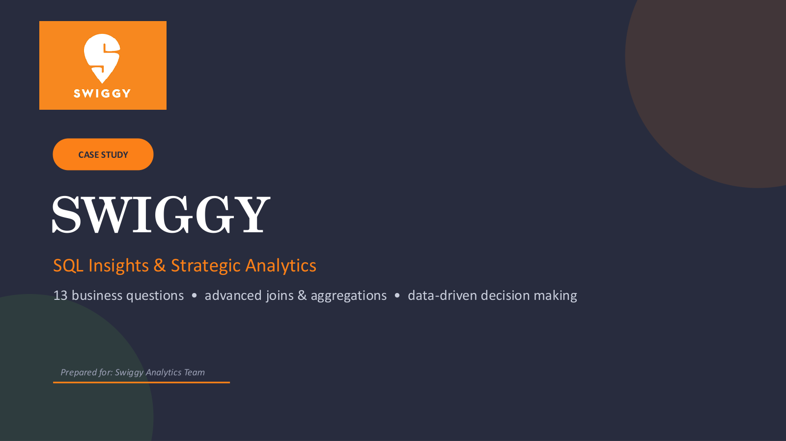

<h1 align="center">Swiggy — SQL Query Portfolio</h1>

<p align="center">
  
  
  
  
  
  
</p>

<p align="center">
  
</p>

## Overview

A 13-question SQL case study on a Swiggy-style food delivery dataset covering customers, restaurants, orders and delivery partners. Swiggy wants insights from its data, so the project moves from simple filters up through joins, aggregation, subqueries and self-joins, answering business questions about customer behaviour, restaurant performance and delivery operations.

A companion PPT in this repo walks through every question with its query and output side by side.

## The Questions

<details>
<summary><b>Easy (4)</b></summary>

1. Display all customers who live in 'Delhi'.
2. Find the average rating of all restaurants in 'Mumbai'.
3. List all customers who have placed at least one order.
4. Display the total number of orders placed by each customer.

</details>

<details>
<summary><b>Medium (6)</b></summary>

5. Find the total revenue generated by each restaurant.
6. Find the top 5 restaurants with the highest average rating.
7. Display all customers who have never placed an order.
8. Find the number of orders placed by each customer in 'Mumbai'.
9. Display all orders placed in the last 30 days.
10. List all delivery partners who have completed more than 1 delivery.

</details>

<details>
<summary><b>Hard (3)</b></summary>

11. Find the customers who have placed orders on exactly three different days.
12. Find the delivery partner who has worked with the most different customers.
13. Identify customers who have the same city and have placed orders at the same restaurants, but on different dates.

</details>

*The Easy / Medium / Hard split is my own grouping by the SQL concepts each question needs.*

## Techniques Used

`WHERE` filters · `JOIN` / `LEFT JOIN` · `GROUP BY` & `HAVING` · Aggregate functions (`SUM`, `AVG`, `COUNT`, `COUNT(DISTINCT)`) · `ORDER BY` / `LIMIT` ranking · Date functions · Subqueries · Self-joins

*Trim this to the techniques your queries actually use.*

## Repository Structure

```
swiggy-sql-query-portfolio
├── swiggy_queries.sql             ← All SQL queries (add your file here)
├── Swiggy_SQL_Portfolio.pptx      ← Query + output walkthrough (add your file here)
├── cover.png                      ← Repo cover image
└── README.md
```

---

## About Me

**Anmol Agarwal**
Business Analyst

[](https://www.linkedin.com/in/anmol-agarwal123/)
[](https://github.com/Anmolagarwal19)
[](mailto:agarwalanmol799@gmail.com)

*If this project was useful, a star on the repo is appreciated — feel free to reach out for feedback, questions, or opportunities.*
